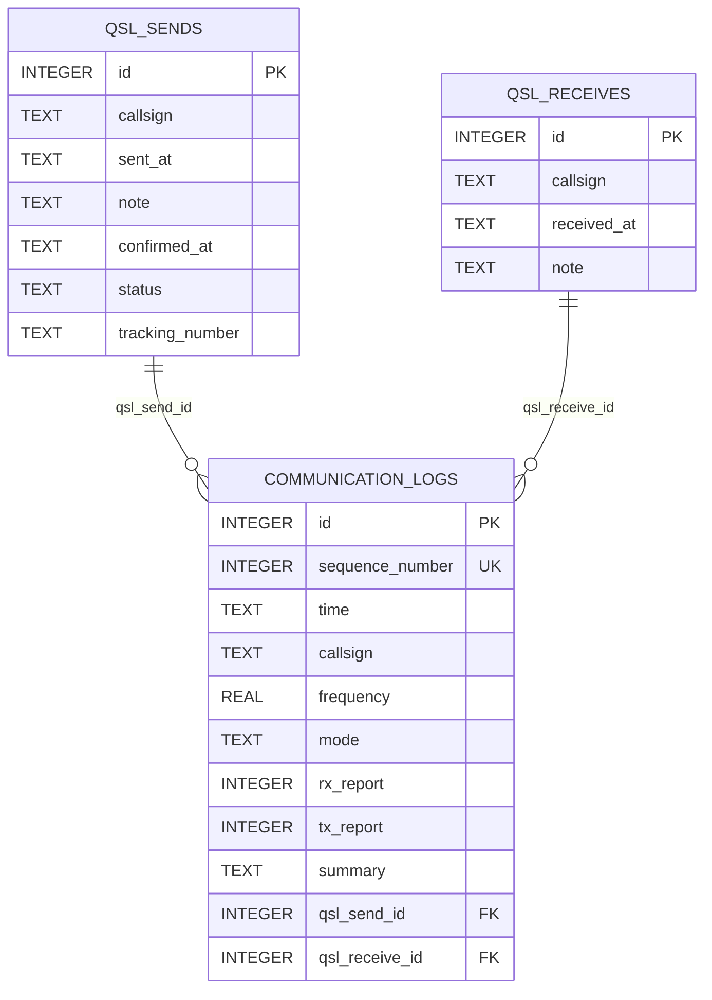
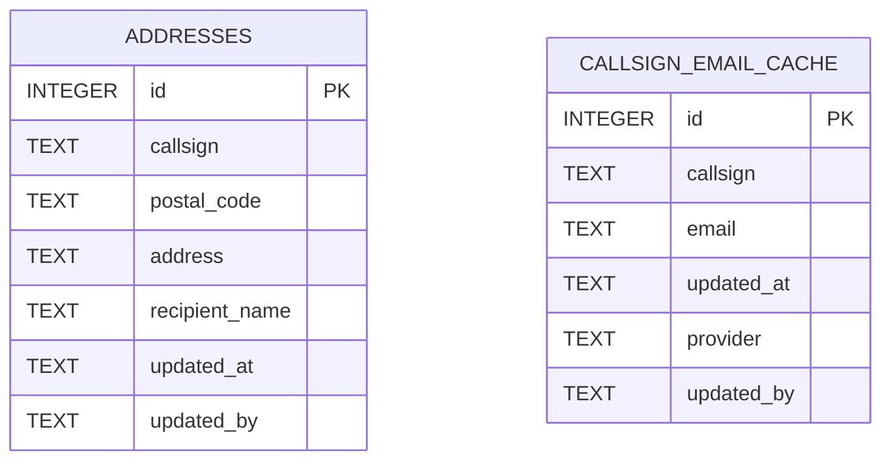

# 数据库

项目使用两个本地 SQLite 数据库：个人库默认是 `data/logbook.db`，保存通联和 QSL；公共库默认是 `data/public.db`，保存地址及呼号邮箱映射。路径可分别由 `config/values.ts` 配置。本页记录新建数据库结构；已有个人库可能保留迁移前的地址列和公共表，显式迁移只复制数据，不删除旧库内容。

## 概览

- 个人库 `PRAGMA user_version = 7`，包含 `communication_logs`、`qsl_sends`、`qsl_receives`
- 公共库 `PRAGMA user_version = 1`，包含 `addresses`、`callsign_email_cache`
- 无业务视图或触发器
- 所有业务表均使用 `INTEGER PRIMARY KEY AUTOINCREMENT`
- 服务端连接会启用 SQLite 外键
- 两个数据库均使用 WAL 日志模式；正常启动默认检查点，可用 `--no-checkpoint` 跳过（显式迁移始终先检查点）

## 实体关系

通联表只有 QSL 两个外键，均允许 `NULL`，使用 `ON DELETE SET NULL` 和 `ON UPDATE CASCADE`。地址是否存在通过附加的公共库按呼号查询，不建立跨库外键。

公共库实体：

## 表结构

### `communication_logs`

| 列 | 类型 | 可空 | 约束/说明 |
| --- | --- | --- | --- |
| `id` | INTEGER | 否 | 主键，自增 |
| `time` | TEXT | 否 | 通联时间；应用按文本排序 |
| `callsign` | TEXT | 否 | 呼号 |
| `frequency` | REAL | 否 | 频率 |
| `mode` | TEXT | 否 | 模式 |
| `rx_report` | INTEGER | 否 | 接收报告 |
| `tx_report` | INTEGER | 否 | 发送报告 |
| `summary` | TEXT | 是 | 摘要 |
| `qsl_send_id` | INTEGER | 是 | 外键到 `qsl_sends.id` |
| `qsl_receive_id` | INTEGER | 是 | 外键到 `qsl_receives.id` |
| `sequence_number` | INTEGER | 否 | 默认 0，由唯一索引保证唯一 |

数据库本身没有日期格式或报告范围的 `CHECK`，约束由应用层 Ajv 执行。

### `addresses`（公共库）

| 列 | 类型 | 可空 | 约束/说明 |
| --- | --- | --- | --- |
| `id` | INTEGER | 否 | 主键，自增 |
| `callsign` | TEXT | 否 | 对应的呼号 |
| `postal_code` | TEXT | 否 | 邮政编码 |
| `address` | TEXT | 否 | 邮寄地址 |
| `recipient_name` | TEXT | 是 | 收件人 |
| `updated_at` | TEXT | 是 | 更新时间；数据库允许空，当前 API 写入非空值 |
| `updated_by` | TEXT | 否 | 提供者呼号；与 `callsign` 组成唯一键 |

### `qsl_sends`

| 列 | 类型 | 可空 | 说明 |
| --- | --- | --- | --- |
| `id` | INTEGER | 否 | 主键，自增 |
| `callsign` | TEXT | 否 | 呼号；不唯一，可保存历史 |
| `sent_at` | TEXT | 否 | 发件日期 |
| `note` | TEXT | 是 | 备注；当前 API 未公开 |
| `confirmed_at` | TEXT | 是 | 对方确认日期；由版本迁移补充 |
| `status` | TEXT | 是 | 发件状态；仅可为 `received`、`returned`、`not_received` 或 `NULL`，默认 `NULL` |
| `tracking_number` | TEXT | 是 | 物流单号，默认 `NULL` |

### `qsl_receives`

| 列 | 类型 | 可空 | 说明 |
| --- | --- | --- | --- |
| `id` | INTEGER | 否 | 主键，自增 |
| `callsign` | TEXT | 否 | 呼号；不唯一，可保存历史 |
| `received_at` | TEXT | 否 | 收件日期 |
| `note` | TEXT | 是 | 备注；当前 API 未公开 |

### `callsign_email_cache`（公共库）

| 列 | 类型 | 可空 | 说明 |
| --- | --- | --- | --- |
| `id` | INTEGER | 否 | 主键，自增，也是相同时间的排序依据 |
| `callsign` | TEXT | 否 | 规范化呼号 |
| `email` | TEXT | 否 | 邮箱；与 `updated_by` 组成大小写不敏感唯一键 |
| `updated_at` | TEXT | 否 | 更新时间 |
| `provider` | TEXT | 否 | 来源，例如 `select:qrz.com` 或 `manual` |
| `updated_by` | TEXT | 否 | 提供者呼号 |

每个提供者可独立保存同一邮箱的呼号映射。查询多个贡献者时，当前配置呼号优先，其次按 `updated_at DESC, id DESC`。同一提供者写入已存在邮箱时，只更新该提供者自己的记录。`manual` 为手动更新邮箱的固定来源值，服务端不会接受来自调用方的 `provider` 覆盖。

## 索引

| 表 | 索引 | 列 |
| --- | --- | --- |
| `addresses` | `idx_addresses_callsign_updated_by` | `callsign, updated_by`，UNIQUE |
| `addresses` | `idx_addresses_callsign_owner_updated_at` | `callsign, updated_by, updated_at DESC, id DESC` |
| `communication_logs` | `idx_communication_logs_time` | `time` |
| `communication_logs` | `idx_communication_logs_time_id` | `time DESC, id DESC` |
| `communication_logs` | `idx_communication_logs_sequence_number` | `sequence_number`，UNIQUE |
| `communication_logs` | `idx_communication_logs_callsign` | `callsign` |
| `communication_logs` | `idx_communication_logs_callsign_time_id` | `callsign, time, id` |
| `communication_logs` | `idx_communication_logs_callsign_time_frequency` | `callsign, time, frequency` |
| `communication_logs` | `idx_communication_logs_qsl_send_id` | `qsl_send_id` |
| `communication_logs` | `idx_communication_logs_qsl_receive_id` | `qsl_receive_id` |
| `qsl_sends` | `idx_qsl_sends_callsign` | `callsign` |
| `qsl_receives` | `idx_qsl_receives_callsign` | `callsign` |
| `callsign_email_cache` | `idx_callsign_email_cache_callsign_owner_updated_at` | `callsign, updated_by, updated_at DESC, id DESC` |
| `callsign_email_cache` | `idx_callsign_email_cache_email_owner_nocase` | `email COLLATE NOCASE, updated_by`，UNIQUE |

## 关联和写入语义

- 新增通联时关联最新 QSL 发件和最新 QSL 收件；地址状态按公共库中是否存在该呼号计算。
- 地址按 `(callsign, updated_by)` upsert；查询单条记录时优先选择当前配置呼号提供的数据。
- 新增 QSL 发件或收件后，为同呼号且对应外键为空的通联补充关联。
- 后续地址新增不修改个人库通联行；地址查询与通联列表通过 `callsign` 关联。
- 新建个人库不含地址列或地址表；旧库中的兼容列和表不会由公共数据迁移删除。

## 迁移边界

个人库迁移可从旧版本增量升级到版本 7；新建公共库会在启动时创建两张公共表。公共库若已有无 `updated_by` 的旧表，原表会保留为 `_legacy` 备份，数据复制到带 owner 的新表。旧个人库中的地址和邮箱数据只由 `--migrate-public-data` 显式复制；默认冲突以 WARN 报告并跳过，`--overwrite-public-data` 可在迁移时整条覆盖。两种方式均不删除个人库原数据。迁移执行前会检查点两个数据库。

## 初始化与重建

全新部署使用服务端 `--init` 创建个人库（版本 7）；公共库按配置路径在启动时自动创建。若个人库已存在，`--init` 输出警告并忽略，不会重建该文件。

数据库相关启动步骤失败时，服务端以非零码退出。修复前应备份个人库和公共库及各自 WAL 文件；不要把 `--init` 当作现有数据库修复命令，也不要在未确认备份可恢复前删除数据库文件。

## 维护建议

- 在任何新增数据库连接上执行 `PRAGMA foreign_keys = ON`。
- 始终使用零填充的 `YYYY-MM-DD` 或 `YYYY-MM-DD HH:mm`，保持文本排序与时间排序一致。
- 不要手动修改 `sqlite_sequence`。
- 修改表结构时同步更新迁移、`user_version`、共享模型和本文档。
- 数据写入前备份个人库和公共库；备份前应执行 WAL 检查点，或同时复制各自的 `-shm`、`-wal` 文件。
- `sequence_number` 如与 `time ASC, id ASC` 不一致，使用服务端维护参数修复，不应直接逐行交换唯一值。
